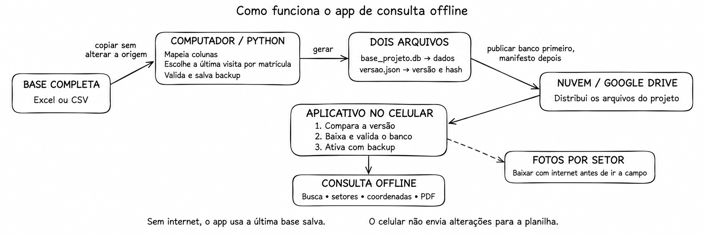

# Consulta de Campo — modelo para novos projetos

Aplicativo Android de consulta offline, derivado da estrutura do app USIS. A equipe prepara uma base no computador e a publica; o celular baixa uma cópia validada e trabalha sem conexão. **Não é um aplicativo de coleta:** alterações feitas no campo não retornam à planilha.

Este pacote não leva bases reais, contas Expo, IDs de distribuição, tokens ou credenciais dos projetos anteriores. Não há publicação automática ao instalar ou executar o modelo.



## Comece aqui

1. [Iniciar um projeto e gerar a demonstração](docs/01-INICIAR-PROJETO.md).
2. [Preparar e mapear a base](docs/02-BASES-E-COLUNAS.md).
3. [Publicar e sincronizar no celular](docs/03-PUBLICACAO-E-SINCRONIZACAO.md).
4. [Rotina, recuperação e passagem de responsabilidade](docs/04-OPERACAO-E-PASSAGEM.md).
5. [Preparar o repositório GitHub](docs/05-GITHUB.md).
6. [Arquitetura e diagrama editável](docs/06-ARQUITETURA.md).

## Demonstração local

No PowerShell, dentro da pasta extraída:

```powershell
python -m venv .venv
.\.venv\Scripts\python.exe -m pip install -r pipeline\requirements.txt
Copy-Item projeto.exemplo.json projeto.json
.\.venv\Scripts\python.exe pipeline\atualizar.py exemplos\base_ficticia.csv
.\.venv\Scripts\python.exe -m unittest discover -s pipeline\tests -v
npm ci
npm run typecheck
npm start
```

O exemplo tem quatro visitas fictícias: duas do mesmo imóvel, uma de outro imóvel e uma sem matrícula. O resultado esperado é **2 imóveis**, com a última visita da matrícula `00001` e exclusão da linha sem matrícula. A base gerada fica no computador; aparecer no celular exige seguir a publicação do guia 03.

## O que vem no modelo

- Interface de setores, busca, detalhes, coordenadas e PDF por município.
- SQLite local e sincronização com progresso, validação e backup de ativação.
- Download de fotos por setor, separado do banco.
- Importador configurável, base fictícia e testes de regras de dados.
- Publicador para arquivos existentes em uma pasta exclusiva no Google Drive.
- Verificação de arquivos rastreados e workflow de CI para GitHub.

O nome da tela e do PDF acompanha `expo.name` em `app.json`. O aplicativo mantém a apresentação de uma foto principal; o pipeline também suporta o campo de foto secundária, cuja exibição precisa ser adaptada se necessária. Os módulos herdados de revisitas não representam um segundo fluxo de dados configurado neste modelo.

## Limites e decisões de implantação

A interface foi reaproveitada; o importador genérico foi preparado para este modelo. O primeiro APK de cada novo projeto precisa de homologação em Android real. A primeira carga e o download de fotos exigem internet. Maps pode depender de conexão ou de mapas previamente baixados no aplicativo externo.

Os links de distribuição precisam retornar os arquivos sem uma tela de login, pois este modelo **não implementa autenticação de usuários no celular**. Não publique dados que exijam controle individual de acesso até implementar essa camada. Hashes detectam divergência de download, não substituem autenticação. O cadastro do projeto e a política de dados devem ser aprovados pela organização responsável.

Tecnologia de partida: Expo 56, React Native e TypeScript no app; Python 3.11+ no pipeline. O `package-lock.json` fixa a árvore herdada. Antes de distribuir comercialmente ou atualizar dependências, revise compatibilidade e segurança com a equipe técnica.

Não foi atribuída uma licença de redistribuição ao código: a empresa deve definir a licença e a visibilidade apropriadas antes de tornar o repositório público.
