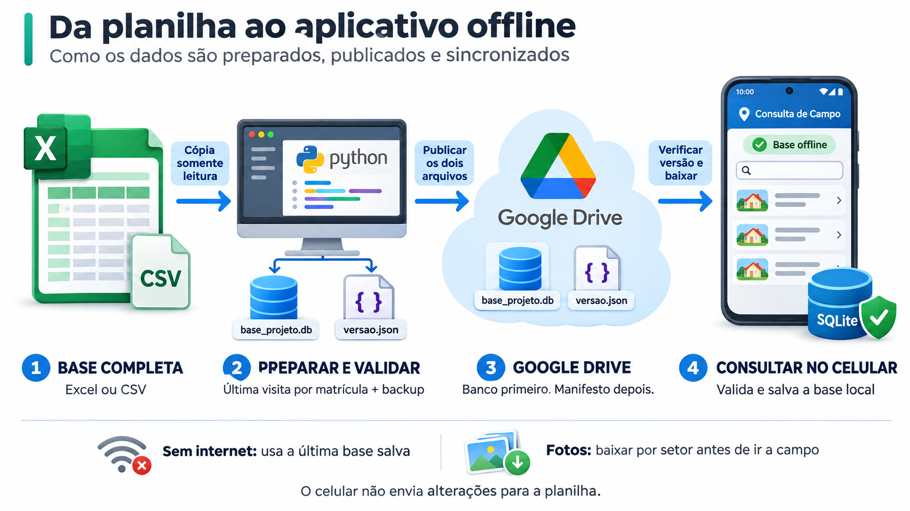
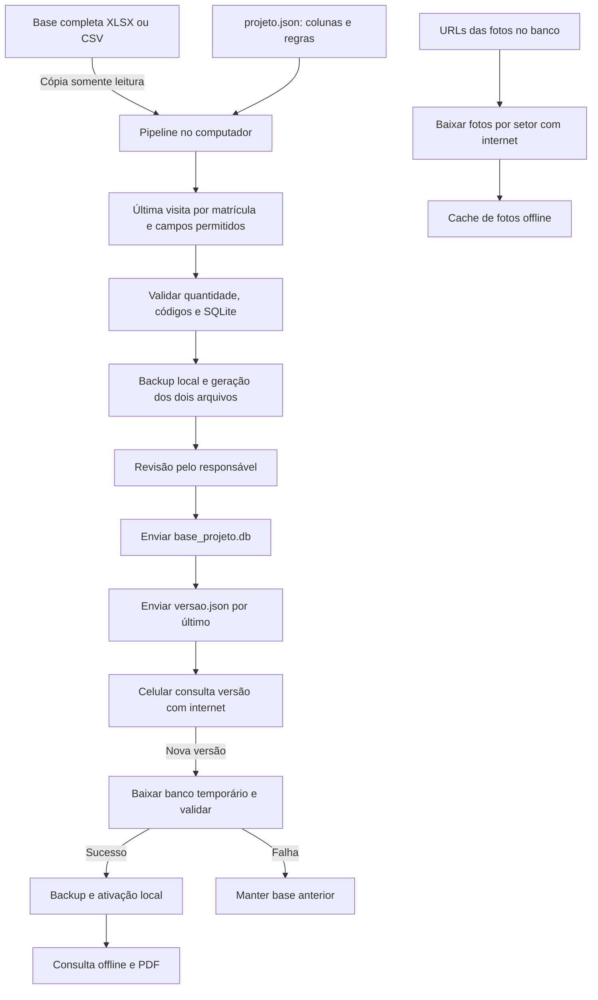

# 06 · Arquitetura para manutenção

O Excel/CSV é a origem operacional; o SQLite é uma cópia reduzida de consulta. O computador não fica atendendo os celulares: depois de publicar, eles obtêm os dois arquivos do destino configurado. Não há API própria nem serviço de escrita de campo neste modelo.

## Mapa do código

| Caminho | Responsabilidade |
| --- | --- |
| `projeto.exemplo.json` | Modelo do mapeamento e opções do pipeline |
| `pipeline/atualizar.py` | Snapshot, leitura, consolidação, proteção de queda, SQLite, manifesto e backup |
| `pipeline/publicar.py` | OAuth, verificação de destino, envio e readback |
| `src/config.ts` | URLs vindas de EXPO_PUBLIC_ ou expo.extra |
| `src/services/database.ts` | Conexão e consultas SQLite da base principal |
| `src/services/databaseUpdate.ts` | Download temporário, comparação de versão, validação e ativação com backup |
| `src/services/offlinePhotos.ts` | Cache e download das fotos por setor |
| `src/components/RevisitsView.tsx` | Interface herdada usada para os setores e detalhes |
| `src/services/pdfReport.ts` | PDF offline a partir da base instalada |
| `src/app/index.tsx` | Abas e diagnóstico/sincronização |
| `src/app/_layout.tsx` | Inicialização; código de verificação OTA fica inativo enquanto updates estiver desabilitado |

Os arquivos `revisitDatabase.ts` e `revisitDatabaseUpdate.ts` são módulos herdados, mantidos para evitar quebrar referências/tipos. Não há publicação de uma segunda base de revisitas no modelo. A aba Setores trabalha com a base principal. Não preencha URLs extras sem implementar e testar esse fluxo.

## Contrato de dados

Tabela: `imoveis`; chave única sem distinguir caixa: `codigo_unico`. Campos técnicos: `codigo_deep_base`, `code_deep`, `numero_visita`. Campos de tela: município, setor, endereço, coordenadas, status, datas e URLs de foto. `grupo_sincronizacao` é formado de município + setor. Veja a lista permitida `FIELDS` em `atualizar.py`.

O manifesto tem `versao`, `schemaVersion`, `publicadoEm`, `totalRegistros`, `tamanhoBanco`, `md5Banco`, `hashBanco` e `versaoMinimaApp`. O cliente valida MD5, tamanho, SQLite e contagem; SHA-256 fica disponível para auditoria. Nenhum desses hashes é uma assinatura criptográfica de autoria.

## Fronteiras importantes

- GitHub distribui o **código do modelo**. O destino HTTPS/Drive distribui **os dados do projeto**.
- Atualizar a planilha não atualiza o app sem executar a geração e a publicação.
- Atualizar o banco não transfere automaticamente as fotos; as URLs apontam para um servidor de imagens separado.
- Consulta offline exige que o aparelho tenha concluído a carga ao menos uma vez.
- O app não grava visitas no servidor nem atualiza o arquivo de origem.
- Data da última visita não prova a data da última alteração no backoffice. O texto herdado da tela de diagnóstico foi ajustado no modelo para evitar essa equivalência.

## Referências para o desenho do fluxo

A imagem do projeto usa ícones de planilha, computador/Python, Google Drive e celular para mostrar o caminho dos arquivos. Referências visuais consultadas:

- [Couchbase — Offline-first mobile apps](https://www.couchbase.com/blog/offline-first-more-reliable-mobile-apps/): representação visual de nuvem, dispositivos e armazenamento local.
- [Android Developers — Build an offline-first app](https://developer.android.com/topic/architecture/data-layer/offline-first): separação entre dados de rede e fonte local do aplicativo.
- [Google Drive — recursos da marca](https://developers.google.com/workspace/drive/api/guides/branding): identificação visual da integração com Google Drive.

São referências de apresentação, não dependências do aplicativo. O desenho deste repositório é uma ilustração gerada para explicar o modelo. Google Drive é uma marca do Google. Os produtos ilustrados não indicam patrocínio ou certificação.

O fluxo implementado aqui distribui uma cópia completa da base do computador para o celular. Diagramas de outras plataformas podem mostrar escrita e sincronização nos dois sentidos; essas funções não fazem parte deste modelo.
